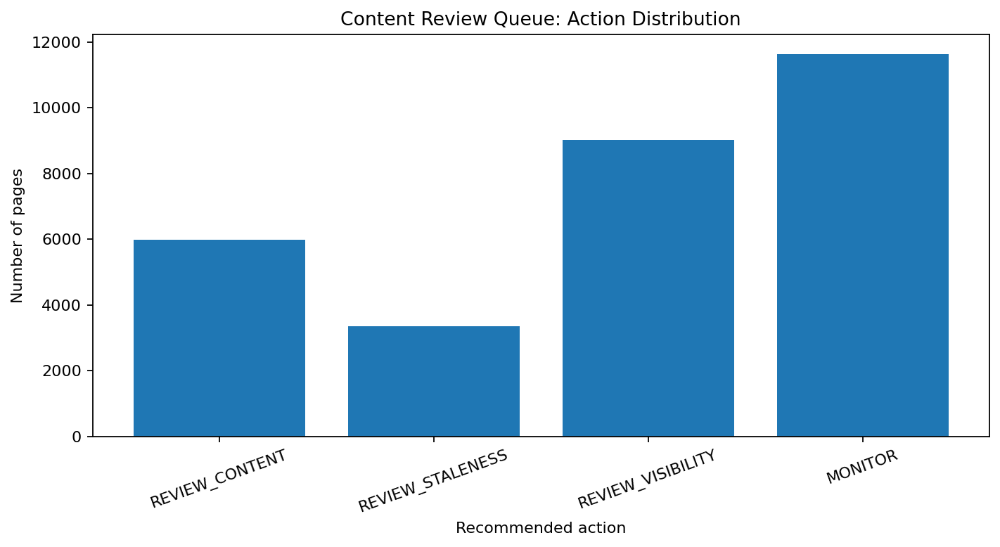

# Prioritizing Content Refresh Opportunities Using Explainable Signals and Machine Learning

## Abstract

This study investigates how content teams can prioritize web pages for review when search performance declines. It uses an anonymized dataset of 30,000 content records and defines an observed decline label from the dataset's trend direction. A transparent rule-based baseline is compared with Logistic Regression using an 80/20 client-grouped held-out split. Logistic Regression achieved Precision@10 of 0.60 and Precision@20 of 0.65, compared with 0.40 for both metrics under the baseline. These results suggest that model-assisted ranking may support human review, although modest overall discrimination and the absence of future-period validation limit the conclusions.

## 1. Introduction and Problem Statement

Content strategists and SEO teams often need to decide which existing pages deserve attention first. Reviewing every page manually can be inefficient, while relying only on page age or traffic may overlook other useful signals.

This study investigates whether simple, explainable rules and machine learning can help organize a content-review queue. The practical decision is which pages should be reviewed first and which signals explain their priority.

The objective is to evaluate review prioritization, not to establish the cause of declining search performance or guarantee that updating a page will improve rankings.

**Research question:** Why do some web pages experience declining search performance, and how can content teams identify which pages should be reviewed first for potential content improvements?

## 2. Data

This study uses the anonymized FlyRank content-refresh starter dataset, containing 30,000 rows and 44 original columns. The records include content characteristics, search-demand attributes, engagement metrics, freshness information, and performance trends. The derived target adds a 45th column during analysis.

### Target definition

The binary target, `is_declining_label`, is derived from `trend_direction`: records with a value of `down` are labelled 1, and all other categories are labelled 0. This is an observed decline proxy, not independent confirmation that a page requires refreshing.

### Data quality and exclusions

The dataset contains missing values in several fields. For example:

- `provider_used` is missing in 21,438 rows (71.46%).
- `word_count` and `char_count` are each missing in 7,699 rows (25.66%).
- `model_used` is missing in 5,733 rows (19.11%).
- `trend_pct` is missing in 3,388 rows (11.29%).

Missing values are handled through training-fitted preprocessing rather than indiscriminately replacing them with zero. Identifier fields are excluded from predictive inputs. The `client_id` field is used only to group records for validation.

The six fields comparing the latest 30 days with the previous 30 days are excluded from predictive inputs to reduce direct target-leakage risk. The target and target-derived trend fields are also excluded.

### Observation windows and privacy

Available metrics include 90-day aggregates and comparisons between recent 30-day windows. However, the dataset does not provide a complete calendar-dated, point-in-time history suitable for robust future-period evaluation.

Public outputs omit content IDs, client IDs, private URLs, and search queries.

## 3. Methodology

### Rule-based baseline

The Week-4 baseline uses two signals:

- **Staleness:** at least 90 days have passed since the last update.
- **Visibility:** 90-day impressions meet or exceed the median positive impression count of 731.

The baseline assigns two points for staleness and one point for visibility. The resulting scores map to four actions.

| Score | Action | Reason code |
|---:|---|---|
| 3 | `REVIEW_CONTENT` | `STALE_AND_VISIBLE` |
| 2 | `REVIEW_STALENESS` | `STALE_ONLY` |
| 1 | `REVIEW_VISIBILITY` | `VISIBLE_ONLY` |
| 0 | `MONITOR` | `NEITHER_SIGNAL` |

The queue is ordered by priority score, followed by time since the last update and 90-day impressions.

### Logistic Regression

Logistic Regression was evaluated using numeric and categorical features. Identifier fields, target-derived fields, and the six latest-versus-previous 30-day comparison fields were excluded from predictive inputs. Missing-value handling, encoding, and scaling were fitted on training data only.

### Validation design

A reproducible 80/20 client-grouped split used random seed 42.

| Partition | Rows | Clients | Decline-label rate |
|---|---:|---:|---:|
| Training | 23,837 | 25 | 55.01% |
| Testing | 6,163 | 7 | 51.10% |

No clients overlapped between the training and testing partitions. This design evaluates performance on held-out clients but does not establish performance on future time periods.

Precision@10 and Precision@20 measure the proportion of pages with the observed decline label among the highest-ranked pages. Average precision and ROC-AUC provide additional measures of ranking performance and discrimination.

Explicit leakage checks passed for the excluded fields. However, residual temporal leakage cannot be ruled out because a complete point-in-time feature history is unavailable.

## 4. Results: Model Versus Baseline

The baseline and Logistic Regression model were evaluated on the same client-grouped held-out test split.

| Metric | Week-4 rule-based baseline | Logistic Regression |
|---|---:|---:|
| Precision@10 | 0.40 | 0.60 |
| Precision@20 | 0.40 | 0.65 |
| Average precision | Not reported | 0.564 |
| ROC-AUC | Not reported | 0.573 |

Logistic Regression improved Precision@10 by 20 percentage points and Precision@20 by 25 percentage points relative to the baseline on this held-out split.

At the top 10 positions, the model identified six pages with the observed decline label, compared with four for the baseline. At the top 20 positions, it identified 13, compared with eight for the baseline.

The model's ROC-AUC of approximately 0.573 indicates limited overall discrimination. Better precision among a small number of top-ranked pages does not establish strong predictive performance across the dataset.

These results support further investigation of model-assisted review prioritization. They do not justify automatic content changes or guarantee future search performance.

## 5. Limitations and Honest Framing

This study has several limitations.

1. **Proxy target:** The decline label is derived from `trend_direction` and does not independently establish that a page needs a refresh.
2. **Limited discrimination:** The model's ROC-AUC is approximately 0.573, indicating modest overall discrimination.
3. **No future-period validation:** Client-grouped validation prevents client overlap but does not establish performance on future time periods.
4. **Residual temporal leakage risk:** Explicit exclusions reduce direct leakage risk, but some aggregate features may overlap with the target's observation period.
5. **Missing data:** Several metadata and content-characteristic fields have substantial missingness, which may affect model results.
6. **No causal conclusion:** The study does not prove that refreshing a selected page causes improved search performance.
7. **Limited generalizability:** Results come from one anonymized dataset and one grouped train/test split.

The baseline and model should be treated as decision-support tools. Human review remains necessary before any content change.

## 6. Ranked Recommendations

The rule-based action queue contains the following distribution.

| Priority | Recommended action | Pages | Share of queue |
|---:|---|---:|---:|
| 1 | `REVIEW_CONTENT` | 5,992 | 19.97% |
| 2 | `REVIEW_STALENESS` | 3,353 | 11.18% |
| 3 | `REVIEW_VISIBILITY` | 9,015 | 30.05% |
| 4 | `MONITOR` | 11,640 | 38.80% |

### First priority: Review content

The 5,992 pages in `REVIEW_CONTENT` meet both baseline rules: at least 90 days since the last update and at least 731 impressions over 90 days. Review accuracy, completeness, search intent, relevance, and usefulness before deciding whether changes are appropriate.

### Second priority: Investigate stale pages

For `REVIEW_STALENESS`, verify whether information is outdated or needs maintenance. Age alone is not sufficient justification for a refresh.

### Third priority: Investigate visibility

For `REVIEW_VISIBILITY`, examine impressions, click-through rate, relevance, and search intent before selecting an action.

### Fourth priority: Continue monitoring

`MONITOR` means neither baseline rule was met. It does not guarantee that a page is performing well.

Do not automatically rewrite, publish, delete, redirect, or de-index pages based only on a score. Record reviewer decisions and monitor performance over comparable observation windows after changes. A change in performance after a refresh does not, by itself, prove that the refresh caused the change.

## 7. Reproducibility and Artifacts

The supporting repository contains the analysis notebooks, validation checks, action-playbook logic, and code used to generate the paper artifacts.

- **Repository:** [Flyrank-intern-repo](https://github.com/saibalaji2004/Flyrank-intern-repo)
- **ML-08 model evaluation:** [`w05_model.ipynb`](https://github.com/saibalaji2004/Flyrank-intern-repo/blob/main/work/notebooks/w05_model.ipynb)
- **ML-09 validation audit:** [`w06_validation_audit.ipynb`](https://github.com/saibalaji2004/Flyrank-intern-repo/blob/main/work/notebooks/w06_validation_audit.ipynb)
- **ML-10 action playbook:** [`w07_action_playbook.ipynb`](https://github.com/saibalaji2004/Flyrank-intern-repo/blob/main/work/notebooks/w07_action_playbook.ipynb)
- **ML-11 capstone:** [`capstone.ipynb`](https://github.com/saibalaji2004/Flyrank-intern-repo/blob/main/work/notebooks/capstone.ipynb)

### Action queue distribution

The following chart summarizes the distribution of the 30,000 records across the four rule-based review categories.

**Supporting data:**

- [Download the action summary CSV](ml11_action_summary.csv)
- [Download the model-versus-baseline evaluation CSV](ml11_model_vs_baseline.csv)

The action summary describes the baseline queue. The evaluation table reports previously measured ML-08/ML-09 results on the client-grouped held-out split. The ML-11 reporting cell checks consistency of these recorded metrics; it does not independently retrain and reevaluate the model.

The exported artifacts contain aggregate summaries and evaluation metrics rather than content IDs or client IDs.

## 8. Conclusion

The results suggest that Logistic Regression may help content teams rank pages for manual review, achieving higher Precision@10 and Precision@20 than the rule-based baseline on the evaluated client-grouped split.

However, modest overall discrimination, the proxy target, missing data, residual temporal leakage risk, and the absence of future-period validation limit the strength of the conclusions. The action queue is best used to structure editorial investigation rather than automate content changes.

Future work should evaluate the approach on a properly time-separated dataset, collect reviewer feedback, and measure outcomes using a documented evaluation design.

## 9. Acknowledgments and Data Credit

This project was completed as part of the FlyRank ML Internship and uses the anonymized starter dataset provided for the program.

Data and program credit: [FlyRank](https://flyrank.ai).

The analysis is intended for research and decision-support purposes. Results reflect the available dataset and evaluation design and should not be interpreted as guarantees of search performance.
